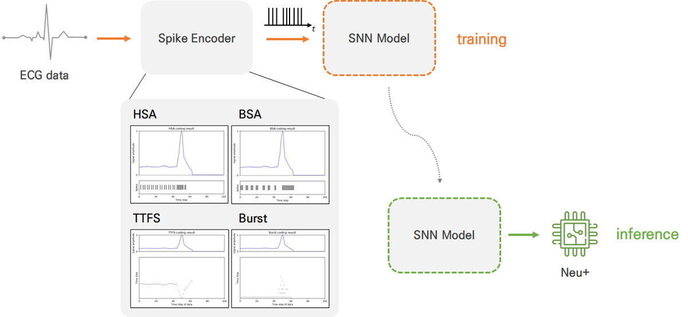
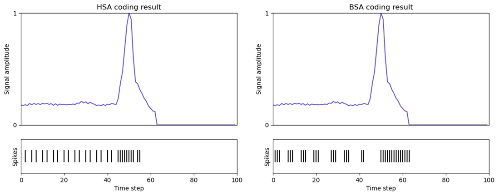
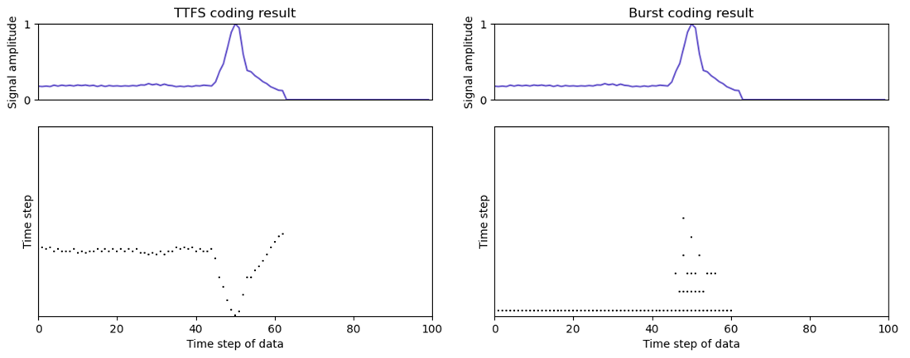
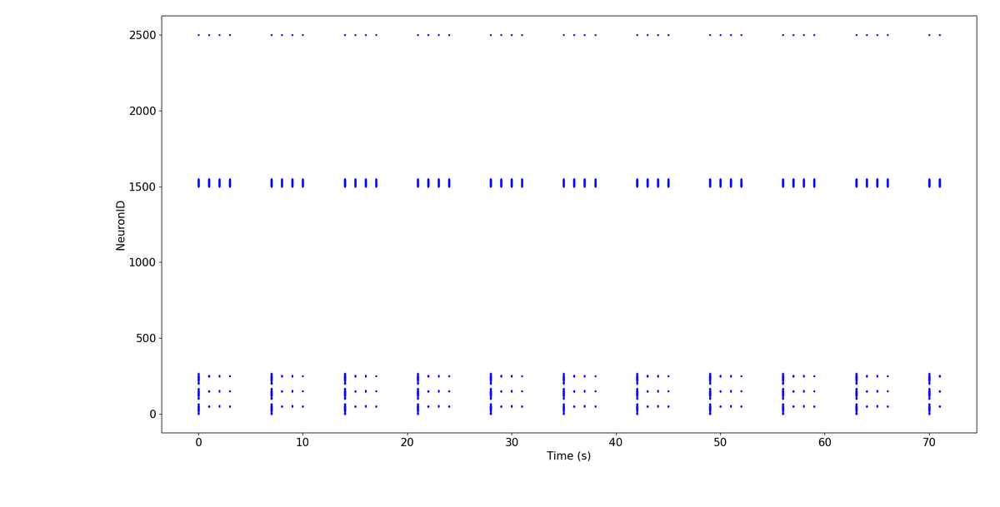

# SNN for ECG Arrhythmia Classification on a Neuromorphic Chip

> 스파이킹 신경망(SNN)으로 심전도의 정상/부정맥을 분류하고, KIST의 뉴로모픽 칩 **Neu+** 위에서 추론까지 구동한 프로젝트

**2023 서울과학기술대학교 전자IT미디어공학과 캡스톤디자인** · 이소은, 최윤선 · 지도교수 최승호
📄 대한전자공학회(IEIE) 2023 추계학술대회 논문 게재 — *시계열 데이터를 위한 스파이크 인코딩 최신 연구 동향*



## 핵심 요약

- 시계열 데이터를 스파이크로 바꾸는 **인코딩 방식 4가지(HSA, BSA, TTFS, Burst)를 직접 구현**하고, 같은 SNN 구조에서 분류 성능과 스파이크 효율을 비교했습니다.
- **Burst coding이 정확도 85.28%로 가장 높았고**, 스파이크 밀도는 HSA의 약 1/30 수준(1.13%)으로 에너지 효율도 뛰어났습니다.
- 뉴로모픽 칩은 바이어스를 지원하지 않기 때문에 **bias-free 모델로 다시 학습**한 뒤, KIST를 방문해 Neu+ 칩에서 실제 추론을 확인했습니다.

## 문제 정의

GPU 기반 신경망은 연산량이 커질수록 병목과 전력 소모가 문제가 됩니다. 뉴로모픽 칩은 뇌의 뉴런·시냅스를 모방해 적은 전력으로 빠르게 연산할 수 있고, 이 장점을 가장 잘 살리는 모델이 이산적인 스파이크로 정보를 전달하는 SNN입니다. 이 프로젝트의 목표는 웨어러블 기기에서의 실시간 부정맥 탐지를 염두에 두고, **심전도 같은 1차원 시계열에 가장 적합한 스파이크 인코딩**을 찾는 것이었습니다.

## 방법

**데이터** — MIT-BIH 부정맥 데이터셋
- R-peak를 기준으로 좌우 50 step씩 잘라 100 step 신호를 만들고, 이를 이어 붙여 300 step 입력을 구성했습니다.
- 5개 클래스(N, S, V, F, Q)를 정상(N)과 부정맥(나머지) 2개 클래스로 통합했습니다.
- 정상 약 7만 개, 부정맥 약 1.5만 개의 불균형을 정상 클래스 언더샘플링으로 맞춰 총 3만 개로 구성했습니다.

**모델** — `입력 300 → LIF 50 → LIF 2`의 fully-connected SNN
- LIF(Leaky Integrate-and-Fire) 뉴런, 시뮬레이션 100 time step
- Surrogate gradient(atan)를 이용한 역전파 학습, cross-entropy loss
- 칩 배포를 위해 모든 층을 `bias=False`로 학습

**스파이크 인코딩**

| 방식 | 분류 | 원리 |
|---|---|---|
| HSA (Hough Spiker) | Deconvolution | FIR 필터 창 전체가 신호 아래에 있을 때 발화하고 신호에서 필터를 뺌 |
| BSA (Ben's Spiker) | Deconvolution | 두 가지 오차를 비교해 발화 여부 결정 |
| TTFS (Time-to-First-Spike) | Temporal | 지수적으로 감소하는 임계값, 값이 클수록 빨리 한 번만 발화 |
| Burst | Temporal | 발화할 때마다 임계값을 β배로 키워 짧은 간격의 스파이크 묶음 생성 |

| HSA / BSA | TTFS / Burst |
|---|---|
|  |  |

## 결과

| 인코딩 | Accuracy (%) | 스파이크 수 | 스파이크 밀도 (%) |
|---|---:|---:|---:|
| HSA | 84.15 | 10,864 | 36.21 |
| BSA | 81.85 | 8,765.8 | 29.22 |
| TTFS | 50.00 | 202.21 | 0.674 |
| **Burst** | **85.28** | 337.93 | 1.126 |

<sub>밀도 = 100 × (스파이크 수) / (데이터 길이 × time step)</sub>

- **Burst**는 적은 스파이크로도 신호의 특징을 잘 잡아, 정확도와 효율을 모두 확보했습니다.
- **TTFS**는 입력마다 한 번만 발화하기 때문에 층을 지날수록 정보가 희미해져 분류에 실패했습니다. 스파이크 밀도가 너무 낮으면 효율은 좋아도 정보가 손실된다는 점을 보여 줍니다.

**뉴로모픽 칩 구동** — KIST 뉴로모픽 컴퓨팅 연구실에서 Neu+ 칩에 학습된 가중치를 올려 추론을 수행했고, 각 뉴런의 발화를 확인했습니다.



## 코드

```
src/
├── encoders.py   # HSA, BSA, TTFS, Burst 스파이크 인코더
└── model.py      # Burst 인코더를 사용하는 SNN 분류기 (나머지 모델도 encoder만 다름)
```

원본 저장소가 남아 있지 않아, **최종보고서에 수록된 핵심 코드(인코더와 모델 구조)를 복원**해 정리했습니다. 데이터 전처리와 학습 스크립트는 포함되어 있지 않습니다.

```bash
pip install torch snntorch scipy
```

```python
from types import SimpleNamespace
import torch
from model import BurstSnn

args = SimpleNamespace(num_steps=100, data_num_steps=300, threshold=0.125,
                       beta=0.5, num_classes=2, device="cpu")
model = BurstSnn(args)
spk_out, n_input_spikes = model(torch.rand(8, 300))  # 입력은 [0, 1] 범위로 정규화
pred = spk_out.sum(0).argmax(1)                      # 출력 뉴런의 발화 수로 분류
```

## 기술 스택

Python · PyTorch · snnTorch · NumPy · SciPy · NVIDIA RTX A5000

## 회고

- 시뮬레이션에서 바이어스를 포함해 높였던 성능을, 칩 제약 때문에 bias-free 구조로 다시 맞춰야 했습니다. 하드웨어 제약을 처음부터 설계에 반영하는 것의 중요성을 배웠습니다.
- 후속 과제로 ANN-to-SNN 변환을 활용한 대용량 모델(Transformer, AutoEncoder)을 칩에서 구동하는 방향을 정리했습니다.

## 참고 문헌

- Schrauwen & Van Campenhout, *BSA, a fast and accurate spike train encoding scheme*, IJCNN 2003
- Park et al., *T2FSNN: Deep spiking neural networks with time-to-first-spike coding*, DAC 2020
- Park et al., *Fast and efficient information transmission with burst spikes in deep spiking neural networks*, DAC 2019
- Kachuee et al., *ECG heartbeat classification: A deep transferable representation*, ICHI 2018
- [snnTorch documentation](https://snntorch.readthedocs.io/)
